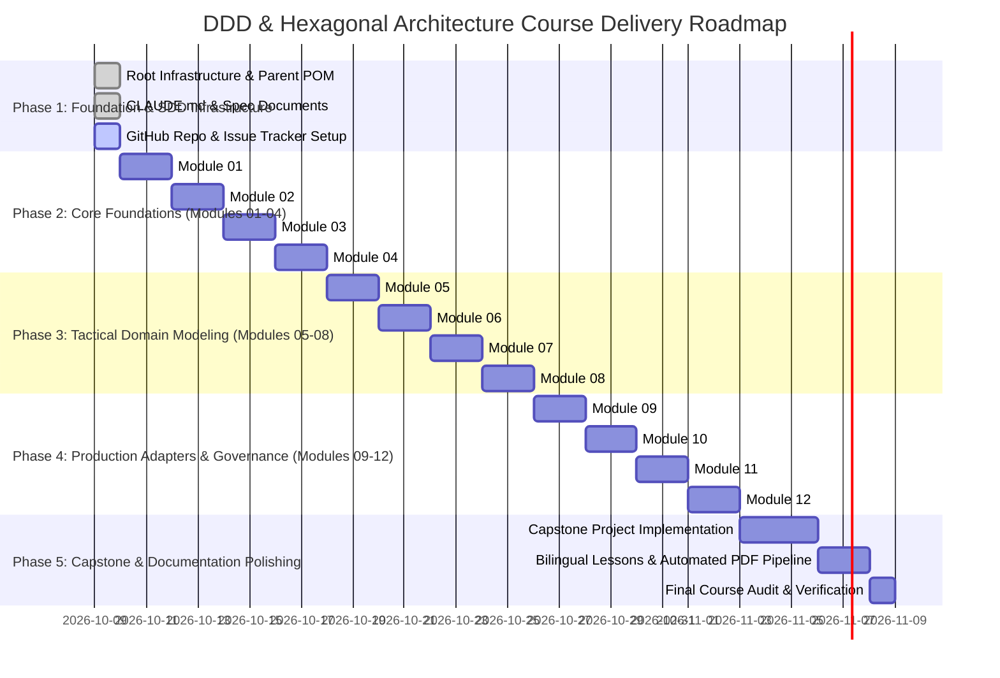

# PLAN.md — Delivery Plan: DDD & Hexagonal Architecture Masterclass

> **Methodology**: Spec-Driven Development (SDD)  
> **Status**: In Progress  
> **Target Baseline**: September 2026 Curriculum (Java 27 & Spring Boot 4)  

---

## 1. Architectural Strategy & Phased Roadmap

---

## 2. Phase Breakdown & Deliverables

### Phase 1: Foundation & SDD Infrastructure
- [x] Create comprehensive `CLAUDE.md` with SDD guidelines, Hexagonal rules, and ArchUnit standards.
- [x] Create `SPEC.md` and detailed `specs/` (00-Curriculum, 01-Architectural Rules, 02-Module Specs, 03-Capstone Spec).
- [x] Create `plan.md` and `todo.md`.
- [x] Create root `pom.xml` with Java 27, Spring Boot 4, ArchUnit, Testcontainers, and multi-module configurations.
- [x] Set up `docker-compose.yml` for PostgreSQL, Kafka, and Mailpit.
- [x] Configure PDF generation tooling (`scripts/generate-pdfs.sh`).
- [ ] Initialize public GitHub repository and create GitHub issues for all milestones.

### Phase 2: Strategic DDD & Core Building Blocks (Modules 01-04)
- **Module 01**: Ubiquitous Language & Strategic DDD (Anemic vs Rich Domain Models).
- **Module 02**: Hexagonal Architecture Blueprint (Ports, Adapters, Inward Dependency Inversion).
- **Module 03**: Value Objects with Java 27 Records (Compact constructors, immutability, zero side effects).
- **Module 04**: Entities & Identity (Entity lifecycle, identity generation, mutation protection).
- *Deliverables*: Dual-language lesson guides (EN/TR), runnable code, exercises with failing tests, verified solutions.

### Phase 3: Tactical Domain & Port Design (Modules 05-08)
- **Module 05**: Aggregates, Aggregate Roots & Consistency Boundaries.
- **Module 06**: Domain Events with Java 27 Sealed Interfaces.
- **Module 07**: Inbound (Driving) Ports & Application Services (Use Cases & CQRS Lite).
- **Module 08**: Outbound (Driven) Ports & Persistence Adapters (Spring Data JDBC / JPA decoupling).
- *Deliverables*: Dual-language lesson guides (EN/TR), runnable code, exercises, verified solutions.

### Phase 4: Adapters, Governance & Distributed DDD (Modules 09-12)
- **Module 09**: Driving Adapters (Modern REST APIs, Problem Details, Virtual Threads).
- **Module 10**: Driven Adapters (Kafka messaging, resilient HTTP clients, Testcontainers).
- **Module 11**: Automated Architectural Governance with ArchUnit.
- **Module 12**: Context Mapping, Anti-Corruption Layer (ACL) & Transactional Outbox.
- *Deliverables*: Dual-language lesson guides (EN/TR), runnable code, exercises, verified solutions.

### Phase 5: Enterprise Capstone Project & Publishing
- **Capstone**: `capstone-order-fulfillment-platform` featuring:
  - Multi-Bounded Context architecture (Ordering + Fulfillment).
  - Transactional Outbox pattern with Kafka and PostgreSQL.
  - Full ArchUnit suite guaranteeing strict boundaries.
  - End-to-end integration tests using Testcontainers.
- Automated script to compile all `lesson.md` and `lesson.tr.md` into polished PDF documents.

---

## 3. Pedagogical Quality Standard

For every module $N$:
1. **Theory to Code Ratio**: 40% Conceptual / Architectural deep dive, 60% hands-on runnable code.
2. **Student Friction Reduction**: Everything must run with a single command `./mvnw clean test` without external manual database setup.
3. **No Magic**: Avoid hidden magic or reflection shortcuts in the domain core.
4. **Bilingual Parity**: Turkish documentation must be as rigorous and complete as the English version.
