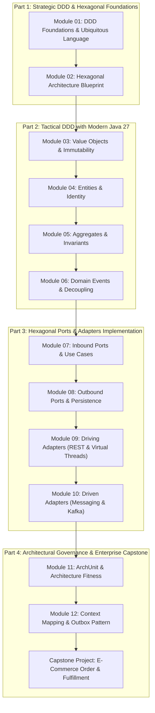

# Curriculum Overview & Pedagogical Syllabus (September 2026)

## Target Audience & Prerequisites
- **Audience**: Professional Java developers, software architects, and students aiming to build maintainable, long-lived enterprise applications.
- **Prerequisites**: Intermediate Java knowledge (Java 21+), familiarity with basic Spring Boot concepts, and understanding of relational databases.

---

## 12-Module Pedagogical Roadmap

---

## Detailed Module Syllabus

### Module 01: Domain-Driven Design Foundations & Ubiquitous Language
- **Theory**: Strategic design vs Tactical design; Core Domain, Supporting Subdomain, Generic Subdomain.
- **Hands-On**: Modeling a real-world banking and e-commerce domain using an agreed Ubiquitous Language glossary.
- **Pitfall Solved**: The "Anemic Domain Model" anti-pattern and how it harms software evolvability.

### Module 02: Hexagonal Architecture Blueprint & Ports/Adapters
- **Theory**: Alistair Cockburn's Ports and Adapters pattern; Dependency Inversion Principle applied to enterprise architecture.
- **Hands-On**: Structuring a multi-package Java project with strict inward-pointing dependencies.
- **Pitfall Solved**: Accidental leaks of JPA and Spring annotations into domain business rules.

### Module 03: Value Objects & Immutability with Java 27 Records
- **Theory**: Characteristics of Value Objects (immutability, conceptual whole, equality by attributes, self-validation).
- **Hands-On**: Implementing `Money`, `Currency`, `EmailAddress`, `PostalAddress` as Java 27 records with compact constructor invariant checks.
- **Pitfall Solved**: Primitive Obsession (`String email`, `BigDecimal amount` without currency).

### Module 04: Entities, Identity & Lifecycle
- **Theory**: Entity definition; Entity identity vs Value Object identity; Mutable vs Controlled state changes.
- **Hands-On**: Building an `Account` and `Customer` entity with natural vs surrogate IDs and business mutation methods.
- **Pitfall Solved**: Public setters exposing domain state to uncontrolled mutation.

### Module 05: Aggregates, Aggregate Roots & Domain Invariants
- **Theory**: What is an Aggregate? Transactional consistency boundary; References between aggregates by ID only.
- **Hands-On**: Designing the `Order` aggregate with `OrderItem` children; Enforcing multi-entity business invariants.
- **Pitfall Solved**: Giant God Aggregates causing transaction lock contention and out-of-memory errors.

### Module 06: Domain Events & Event-Driven Decoupling
- **Theory**: What are Domain Events? Capturing things that happened in the domain; Side-effect decoupling.
- **Hands-On**: Using Java 27 sealed interfaces for Domain Events; Collecting events inside Aggregate Roots.
- **Pitfall Solved**: Directly calling secondary services (email, analytics) from within domain methods.

### Module 07: Inbound (Driving) Ports & Application Services
- **Theory**: Driving Ports as Use Case contracts; Application Services as transaction orchestrators (CQRS Lite).
- **Hands-On**: Implementing `CreateOrderUseCase` and `CancelOrderUseCase` with Command/Query objects.
- **Pitfall Solved**: Fat controllers containing business orchestration logic.

### Module 08: Outbound (Driven) Ports & Persistence Adapters
- **Theory**: Repository as an SPI (driven port); Database entities vs Domain aggregates.
- **Hands-On**: Implementing Spring Data JDBC / JPA persistence adapters and mapping bidirectional representations.
- **Pitfall Solved**: Letting ORM lazy-loading exceptions break domain logic.

### Module 09: Driving Adapters with Spring Boot 4
- **Theory**: Primary adapters: REST APIs, CLI, Event Consumers; RFC 9457 Problem Details for Domain Exceptions.
- **Hands-On**: Building modern Spring Boot 4 REST controllers using Virtual Threads and clean DTO mapping.
- **Pitfall Solved**: Leaking domain objects directly to JSON responses.

### Module 10: Driven Adapters for External Services & Messaging
- **Theory**: Secondary adapters: Kafka event publishing, Third-party payment gateways, Resilient HTTP clients.
- **Hands-On**: Implementing a Kafka publisher driven adapter with Testcontainers integration tests.
- **Pitfall Solved**: Silent failures when external systems are down (missing circuit breakers/retries).

### Module 11: Automated Architectural Governance with ArchUnit
- **Theory**: Architecture as Code; Automated fitness functions to guarantee Hexagonal boundaries.
- **Hands-On**: Writing ArchUnit unit tests in Java that run in CI and fail the build on layer violations.
- **Pitfall Solved**: Architecture erosion over time as new developers join the team.

### Module 12: Context Mapping & Outbox Pattern for Distributed Systems
- **Theory**: Context Mapping (Partnership, Shared Kernel, Customer-Supplier, Conformist, ACL); Transactional Outbox.
- **Hands-On**: Implementing an Outbox table and polling publisher for guaranteed event delivery between bounded contexts.
- **Pitfall Solved**: Dual-write problem (database committed but Kafka publish failed).

---

## Capstone Project
- **Scope**: Complete E-Commerce Order & Fulfillment System
- **Bounded Contexts**: Ordering Context, Fulfillment Context, Notification Context.
- **Deliverables**: End-to-end runnable Spring Boot 4 multi-context application with full test coverage, ArchUnit verification, bilingual guides, and docker-compose environment.
